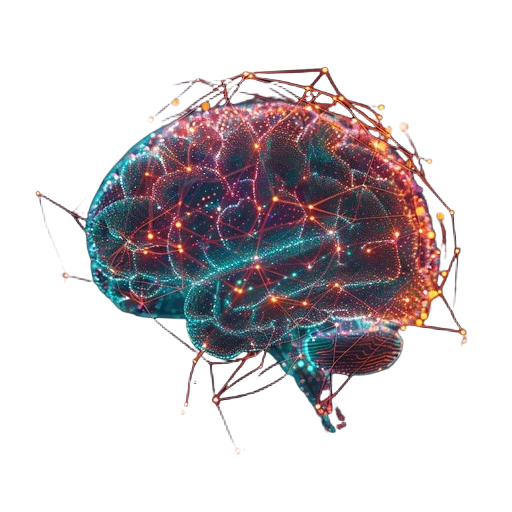

# picsexamlab

**Exam platform for the academy's students and teachers**

*Made for **Picsart Academy** · Made by **rich3r0** & **Mikayel*** · 🇦🇲 [Հայերեն](README.md)

---

## ⬇️ Download

| System | File |
|---|---|
| 🍎 **macOS 13 and newer** (Intel and Apple Silicon) | [**picsexamlab-macOS.dmg**](../../releases/latest/download/picsexamlab-macOS.dmg) |
| 🍎 **macOS 12 Monterey** ¹ | [picsexamlab-macOS-Legacy.dmg](../../releases/latest/download/picsexamlab-macOS-Legacy.dmg) |
| 🪟 **Windows 10 / 11** | [**picsexamlab-Windows.exe**](../../releases/latest/download/picsexamlab-Windows.exe) |
| 🐧 **Ubuntu / Debian** | [**picsexamlab-Linux.deb**](../../releases/latest/download/picsexamlab-Linux.deb) |
| 🐧 Other Linux | [picsexamlab-Linux.AppImage](../../releases/latest/download/picsexamlab-Linux.AppImage) |

¹ The macOS 12 build uses Electron 43, which stops receiving updates on 5 January 2027. It keeps being published, but please update macOS when you can.

> [!NOTE]
> picsexamlab works over the **internet** — you do not need to be on the same Wi-Fi. The app finds the server by itself.

## Install

- **macOS**: open the `.dmg`, drag **picsexamlab** to **Applications**, open it. If macOS says *"Apple could not verify…"* → **Done** → **System Settings → Privacy & Security → Open Anyway**. On macOS 12/13: right-click the app → **Open** → **Open**. If it says *"damaged"*: `xattr -cr /Applications/picsexamlab.app` in Terminal.
- **Windows**: run `picsexamlab-Windows.exe` (no installation). *"Windows protected your PC"* → **More info** → **Run anyway**.
- **Ubuntu / Debian**: double-click `picsexamlab-Linux.deb` → **Install**, or `sudo apt install ./picsexamlab-Linux.deb`. **Other Linux**: `chmod +x picsexamlab-Linux.AppImage && ./picsexamlab-Linux.AppImage` (no FUSE needed).

## 👤 Sign up and log in

1. Open picsexamlab → **Log in / Sign up as User** → **Sign up**: first and last name, a **username** (Latin letters), an **Armenian phone number**, a password. 🔒 Only teachers and Super Users see phone numbers.
2. **Remember me** keeps you logged in (turn it off on a shared computer and press **Logout**).
3. A Super User assigns your **profession** (e.g. AI-Native). Until then you can look at exams but not take them.

**Forgot your password?** Ask your teacher or a Super User for a temporary password; you change it at the next login.

## 📝 Taking an exam

1. Find the exam on the main page (search, profession filter) → open the card → enter the **password** from your teacher → wait until the teacher starts.
2. During the exam the window **cannot be closed**; Alt+Tab, Cmd+Tab and leaving the window are reported to the teacher right away.
3. Answers are saved automatically. If the connection drops or the computer turns off, just open the app again (and log in): picsexamlab **goes back into the exam by itself**, with your answers and the time left.
4. A question for the teacher? Press **💬 Ask the teacher** at the bottom. Replies (and messages to everyone) appear there. This chat is deleted when the exam ends.
5. **SUBMIT** → result. Essay and code points are added after the teacher grades them (you get a notification).
6. **View answers** → detailed review and **PDF**. Then **Main page** or **Close the app**.

Reaching the pass mark puts the exam's **reward** emoji 🏆 on your profile.

## 💬 Channels, chat and members

- **Channels**: move the mouse to the **left edge** of the window → the channel list slides in. Pick a channel → the chat opens over half the window (✕ to close). In 📢 channels only teachers and Super Users write (announcements).
- Write **@username** to mention someone — they get a notification. Send a **picture** (🖼️), edit or delete your own messages.
- **All members**: move the mouse to the **right edge** — Super Users, every profession's teachers and students, 🟢 online. Click a member to open their profile.
- Channels and the member list are hidden during an exam.

## 👩‍🏫 For teachers

- **+** creates an exam: 8 question types (single/multiple choice, true/false, fill in the code, short answer, essay, write code, questions with pictures), points, password, pass mark and reward.
- **✨ Create with AI** (free): in the builder choose the topic, number and types of questions → **📋 Copy** → paste into any AI chat (ChatGPT, Gemini, Claude…) → paste the answer back into picsexamlab → the questions are added as a draft; check them and save.
- **My exams** → exam → **Open session** → **Start**. The Live table shows every student's progress and alerts; 🔓 releases a student's window; **💬** chats with one student, **📣 Everyone** writes to all of them.
- **To grade** list for essays and code; **Results**: TOP 1/2/3, retake permission (↻), PDF/Excel.
- **My students** (Teaching page): your students' phone numbers and **🔑 temporary password** for anyone who forgot theirs.
- Create channels for your profession (left edge → **+**) and remove inappropriate messages.

## ⚡ For Super Users

- **Super User panel**: users and roles (profession, Teacher/Student, 🔑 temporary passwords), professions with pictures, live **logs** (registrations, roles, exams, channels, moderation) and **results export** for every exam (PDF/Excel).
- Channels anywhere (everyone / one profession / teachers), any message can be removed, and **🔇 mute** a user in chat (1 hour, 1 day, until unmuted).

---

made by **rich3r0** & **Mikayel** · for **Picsart Academy**

